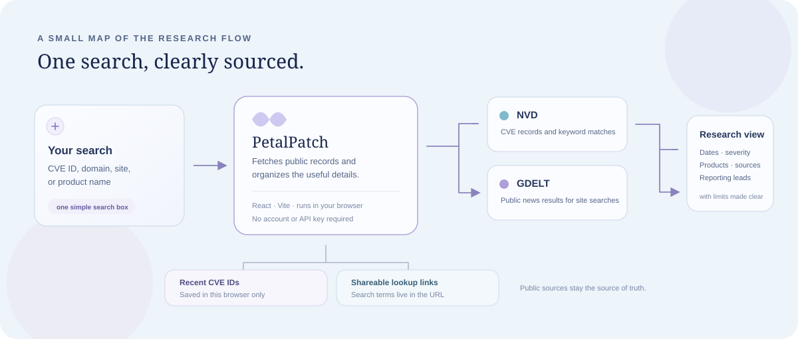

# PetalPatch ✿

<p align="center">
  A little research desk for public vulnerability records.<br />
  Look up a CVE, search a product or domain, and follow the sources.
</p>

<p align="center">
  <a href="https://github.com/ashyyhere/PetalPatch/stargazers"></a>
  <a href="https://github.com/ashyyhere/PetalPatch/issues"></a>
  
  
  
</p>

<p align="center"><a href="#-get-started">Get started</a> · <a href="#-how-it-works">How it works</a> · <a href="#-data--care">Data & care</a> · <a href="#-deployment">Deployment</a></p>

## A quick look

| | Details |
| --- | --- |
| **What it is** | A browser based workspace for researching public CVE records and related reporting. |
| **Built with** | React, TypeScript, and Vite. |
| **Data** | NVD CVE API and GDELT news search. |
| **Backend or API key** | None required; the browser requests public data sources directly. |
| **Search links** | CVE lookups and site searches can be shared through the URL. |

## ✨ What you can do

| Search | What appears |
| --- | --- |
| **CVE ID** | Description, publication and update dates, reporting source, CVSS score when available, affected products, weaknesses, and source references. |
| **Site, domain, or product** | Up to 20 of the newest NVD keyword matches, plus public news coverage from the past six months when available. |
| **Recent lookups** | Up to seven CVE IDs saved in this browser, so you can pick up where you left off. |

## 🌷 How it works

Enter a CVE ID or a search term. PetalPatch fetches the relevant public records, then gives you a readable report with links back to the sources. Recent CVE IDs stay in this browser; search terms are also written to the URL so a lookup can be shared.

<p align="center">
  
</p>

## 🧾 Data & care

| Information | Source | How to read it |
| --- | --- | --- |
| CVE details, dates, scores, affected products, references | [NVD](https://nvd.nist.gov/developers/vulnerabilities) | Fields reflect what NVD has in the record. Missing fields stay marked as unavailable. |
| Site and product matches | NVD keyword search | A match means the term appears in searchable record content; it does not establish that the issue was found or exploited on that domain. |
| Related news | [GDELT](https://blog.gdeltproject.org/gdelt-doc-2-0-api-debuts/) | A research lead, not independent verification of an article’s claims. |
| Discovery or attempted-attack domain | Only when a cited source says so | CVE records usually do not identify where a vulnerability was discovered or attempted. Reference-link domains are shown separately. |
| Reporting source | NVD record | This may be an organization or mailbox, rather than the individual researcher. |

> [!NOTE]
> PetalPatch does not scan websites, confirm exploitability, or infer discovery locations. Follow the linked advisory and source record before drawing conclusions. Public services may rate-limit requests or be temporarily unavailable.

## 🚀 Get started

**Requirements:** Node.js `20.19+` or `22.12+`, and npm.

```sh
git clone https://github.com/ashyyhere/PetalPatch.git
cd PetalPatch
npm install
npm run dev
```

Open the local address printed by Vite. No environment variables or API keys are needed.

## 🛠️ Commands

| Command | Purpose |
| --- | --- |
| `npm run dev` | Start the local development server. |
| `npm run build` | Type-check and create the production site in `dist/`. |
| `npm run preview` | Preview the production build locally. Run the build first. |
| `npm run lint` | Check source files with Oxlint. |

## ☁️ Deployment

This repository is set up for **Cloudflare Workers Builds** with static assets. Connect it to the `petalpatch` Worker and use:

| Setting | Value |
| --- | --- |
| Production branch | `main` |
| Build command | `npm run build` |
| Deploy command | `npx wrangler deploy` |
| Root directory | `/` (repository root) |

`wrangler.jsonc` points the Worker at Vite’s `dist/` output and enables the custom `404.html` page for unknown paths. PetalPatch searches use query strings (for example, `/?cve=CVE-2021-44228`), which continue to work from the home page. If you add client-side routes later, revisit the not-found behavior.

## 🗂️ Project map

| Path | What lives here |
| --- | --- |
| `src/App.tsx` | Search flows, public API requests, and CVE report components. |
| `src/App.css` | Workspace and component styles. |
| `src/index.css` | Global styles and design tokens. |
| `public/` | Static assets and the editable 404 page. |
| `docs/architecture.svg` | The small “how it works” diagram above. |
| `wrangler.jsonc` | Cloudflare Worker name, asset directory, and 404 behavior. |

## 🌱 Contributing

Ideas and bug reports are welcome—[open an issue](https://github.com/ashyyhere/PetalPatch/issues) with what you expected and what happened. Please avoid including private vulnerability details or sensitive target information.

## License

This repository does not include a license yet. Until one is added, reuse and redistribution are not granted.

<p align="center"><sub>Made for curious minds; grounded in public sources. <a href="#petalpatch-">Back to top ↑</a></sub></p>
